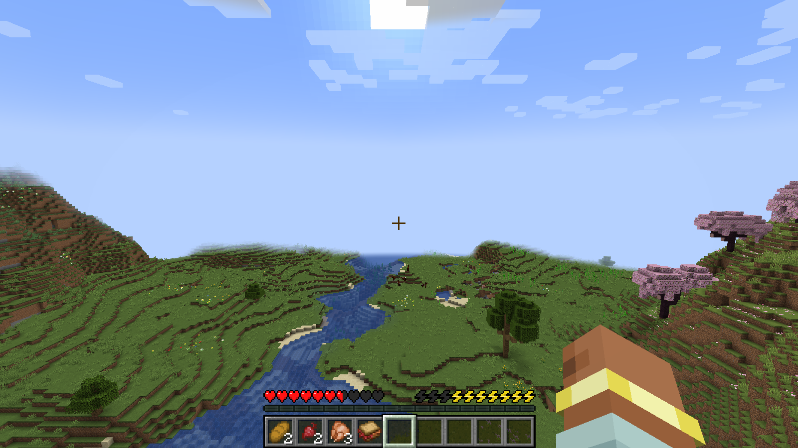
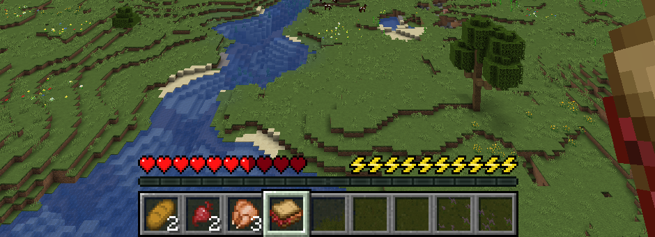
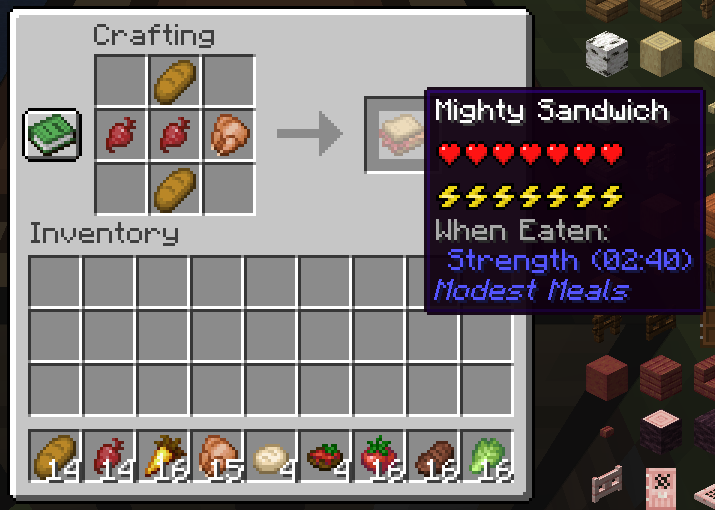
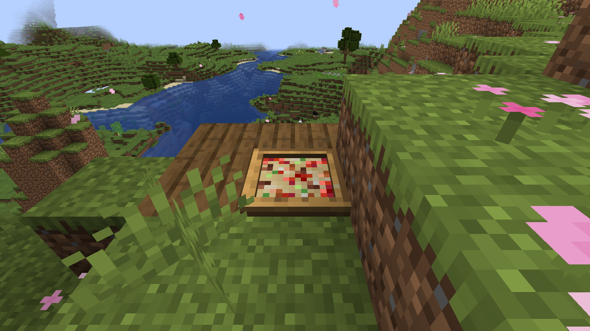
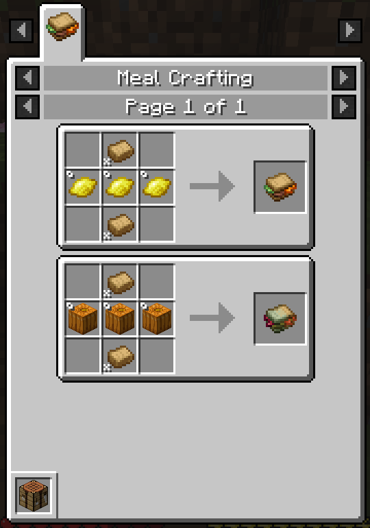
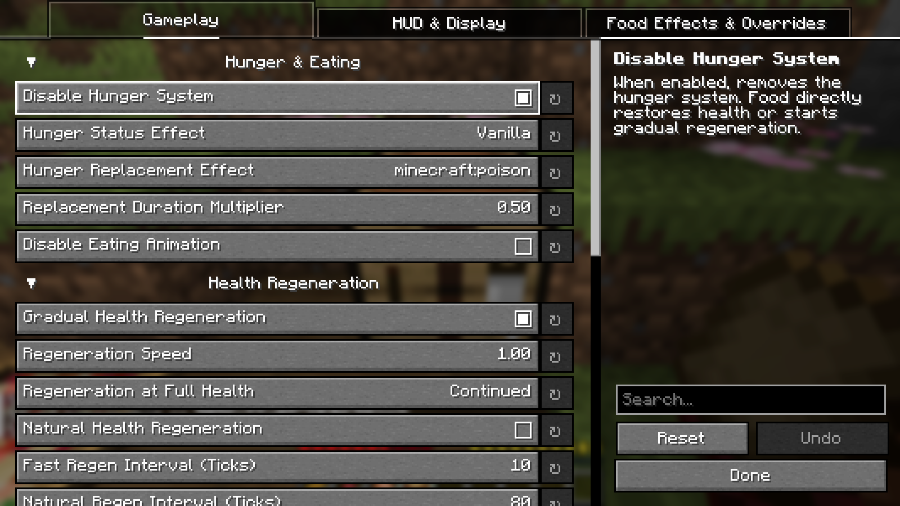
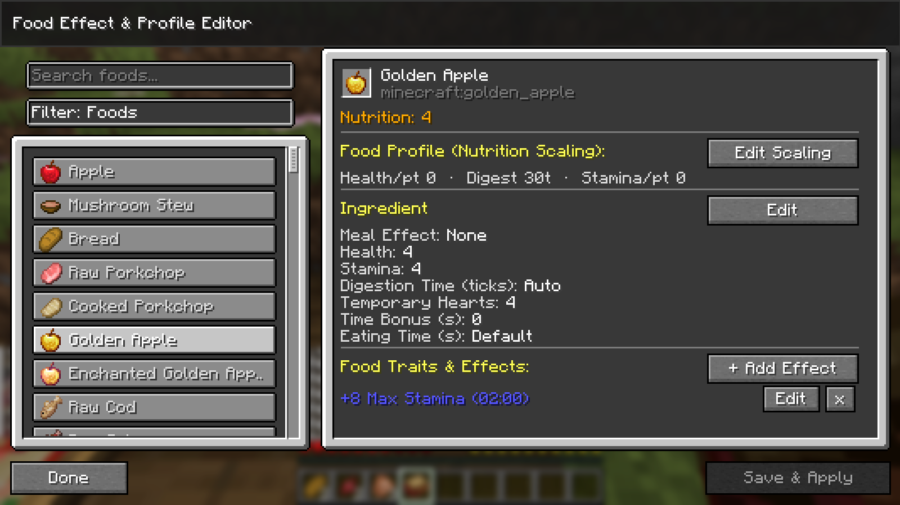

# Modest Meals

Modest Meals is a vanilla-style overhaul of Minecraft's food system. The hunger bar is replaced with a stamina bar,
food heals you directly as you digest it, and you can cook your own meals out of almost any ingredient.

---

## Features

### No more hunger!

- Food heals you gradually as it digests. Light snacks digest quickly, hearty meals heal for longer.
- Hold a food item to see how many hearts it will restore.
- Tooltips show what a food restores and what it adds to a meal.
- The vanilla Hunger effect becomes Drained, which slows stamina recovery. You can also turn it off or swap it for
  another effect.

### Stamina!

- Sprinting drains stamina.
- Use it up and you become exhausted, which prevents sprinting until the bar has fully refilled.
- Stamina refills on its own after a short pause. How fast it refills while you're moving can be configured.
- Some foods and effects change your stamina:
    - **Endurance** gives you a bigger stamina bar.
    - **Nourishment** stops stamina from draining.
    - **Exhausted** stops stamina from refilling.
- Optionally, health can regenerate naturally while your stamina is high, like vanilla saturation healing.

### Meals!

Combine ingredients to make a meal. Each meal's health, stamina, digestion time, and effects come from what you put in
it, and its texture and name change to match.

For example, a sandwich made with beetroot gives Strength, so it's called a **Mighty Sandwich**.

- Ingredients can add effects like Strength, Haste, Night Vision, or Water Breathing. More of an ingredient means a
  stronger, longer-lasting effect.
- Each effect gives the meal a name prefix, like *Hasty* or *Tidal*.
- Ingredients that don't belong in a meal make a **Dubious** meal. It still fills you up but gives no effects.
- Some ingredient combinations make a mod's own dish instead.
    - For example, a beef patty, leafy greens, and tomato in a sandwich gives you Farmer's Delight's Hamburger.
- Pizzas can be placed down and eaten slice by slice.
- With [EMI](https://modrinth.com/mod/emi) installed, every meal has a recipe page showing which ingredients work.

### Customisable

- Nearly everything is configurable in-game with [YACL](https://modrinth.com/mod/yacl), from digestion speed and
  stamina to the HUD layout. You can even turn the hunger replacement off entirely.
- The **Food Effect Editor** lets you view and tweak every food's stats and effects, then save the changes to a
  datapack.
    - On a server, the editor shows that server's food data (read-only).
- All food stats, ingredients, meal types, and meal effects are loaded from datapacks, so modpacks can freely change any
  of them.

---

## Dependencies

**Required:**

- [YetAnotherConfigLib (YACL)](https://modrinth.com/mod/yacl) for the config screen

**Optional integrations:**

| Mod                                                                                                                   | Needed for                                                                                     |
|-----------------------------------------------------------------------------------------------------------------------|------------------------------------------------------------------------------------------------|
| [Farmer's Delight](https://modrinth.com/mod/farmers-delight)                                                          | Cooking-pot meals, Farmer's Delight dishes in meal recipes, Nourishment stops stamina draining |
| [Cultural Delights](https://modrinth.com/mod/cultural-delights)                                                       | Ice cream, made in a cold vat                                                                  |
| [EMI](https://modrinth.com/mod/emi)                                                                                   | Recipe pages for meal crafting, cooking, and chilling                                          |
| [Cold Sweat](https://modrinth.com/mod/cold-sweat), [Thermoo](https://modrinth.com/mod/thermoo) (Frostiful, Scorchful) | *Spicy* and *Chilly* meals give cold and heat resistance                                       |
| [Shield Expansion](https://modrinth.com/mod/shield-expansion)                                                         | Holding up a shield drains stamina, and a successful parry restores some                       |
| [Reliable Gliders](https://modrinth.com/mod/reliable-gliders)                                                         | Gliding drains stamina, and an exhausted player can't glide                                    |
| [Reliable Remover](https://modrinth.com/mod/reliable-remover)                                                         | Meal recipes skip items that have been removed                                                 |

**Incompatible:**

- [Melancholic Hunger & HUD](https://modrinth.com/mod/melancholic_hunger): Modest Meals already includes all of its
  features.
- Nostalgic Tweaks (partially): its stamina system overlaps heavily with Modest Meals', so disable one of them.

---

## License

* **Code**: Licensed under the [LGPL-3.0 License](https://github.com/evanbones/Modest-Meals/blob/1.21.1/LICENSE).
* **Assets**: All Rights Reserved (ARR).

---

## Credits

Art by [Baisylia](https://modrinth.com/user/Baisylia)!

Mod logo by [Raspmary](https://www.curseforge.com/members/raspmary/projects)!

Item textures adapted from Klei's [Matcha Flavoured](https://modrinth.com/datapack/matcha-flavoured) resource pack.

Stamina and health system adapted from Nostalgic
Tweaks ([LGPL-3.0-only](https://github.com/Nostalgica-Reverie/Nostalgic-Tweaks/blob/main/LICENSE.txt)) and Melancholic
Hunger & HUD ([LGPL-3.0-only](https://github.com/antigers/melancholic_hunger/blob/1.21.1/LICENSE)).

---

 
